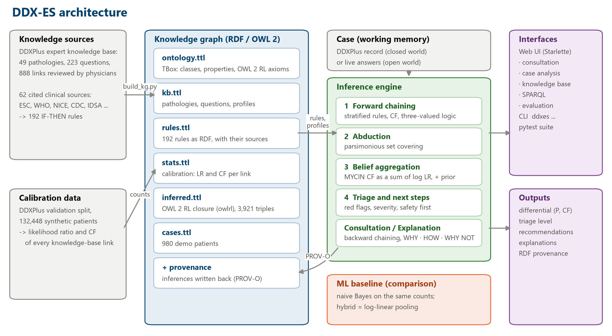

# DDX-ES — an explainable knowledge-graph expert system for differential diagnosis and triage

Final project for **Sistem Pakar Lanjut (Advanced Expert Systems)**, Universitas Gadjah Mada, 2026.

DDX-ES takes a patient's answers to a symptom questionnaire and returns a **differential diagnosis**, a
**triage level** (Emergency, Urgent, Non-urgent, Self-care) and **recommended next steps**. Every conclusion
comes with an explanation: the rules that fired, the facts they matched and the published guideline each rule
encodes. The domain is the 49 respiratory, cardiac and emergency pathologies of the **DDXPlus** dataset
(Fansi Tchango et al., NeurIPS 2022).

**Try it online:** <https://ddx-expert-system.vercel.app>, the web interface deployed on Vercel. Its free-text intake needs a language-model key,
entered in the *Language model* sidebar; everything else works without one.

> ⚠️ Educational prototype built on synthetic data. It is not a medical device and must not be used for clinical
> decisions.

| Assignment requirement | Where it is in this repository |
|---|---|
| Knowledge representation: ontology + knowledge graph (RDF/OWL) | `kg/ontology.ttl` (hand-written TBox, OWL 2 RL axioms) and the generated graph in `kg/*.ttl`: domain knowledge, rule base, calibration statistics, cases, OWL 2 RL closure |
| IF-THEN rules from experts or other knowledge sources, with references | `knowledge/rules.yaml`: 192 rules citing 62 published sources (clinical guidelines, case definitions, diagnostic criteria, decision rules; DOIs checked against Crossref), stored as RDF in `kg/rules.ttl` |
| Reasoning that derives new facts, with explanations | `src/ddxes/engine.py` (forward chaining with certainty factors, abductive set covering, triage) and `src/ddxes/explain.py` (HOW, WHY, WHY NOT, proof trees); conclusions are written back to the graph with W3C PROV-O provenance |
| Combination with other methods (optional) | a naive-Bayes classifier (ML baseline) and a hybrid mode, `src/ddxes/bayes.py`; an optional language-model front end, `src/ddxes/intake.py`, that reads a free-text description in English or Bahasa Indonesia and hands the findings to the rules |
| README with how to run | this file |
| Report and presentation | `docs/slides.pptx` (25 slides); `docs/explainer.pdf`, a plain-language guide with analogies, diagrams and a glossary; `docs/demo_script.pdf`, the live demo on one page; the report (`docs/report.md` → `docs/report.pdf`) is submitted separately and kept out of the repository because it holds personal data |

## Results

On the **full DDXPlus test split (134,529 patients)**, `results/main.json`:

| System | Top-1 | Top-3 | Truth in differential | DDF1 |
|---|---|---|---|---|
| **DDX-ES (expert system)** | **99.42%** | 99.999% | 99.85% | 31.0% |
| Naive Bayes (ML baseline) | 98.58% | 99.996% | 99.99% | 31.0% |
| Hybrid (ES + NB) | 99.70% | 100% | 99.999% | 31.1% |

The true pathology is missing from the top three for 1 patient with DDX-ES, 6 with naive Bayes and none with the
hybrid.

* **Triage:** 100% of emergency cases and 100% of urgent cases are triaged at least as urgent as their true
  pathology requires. Under-triage is 0.38%, all of it non-urgent cases sent to self-care; over-triage is 20.9%,
  mostly chest pain sent to the emergency department by the red-flag rules of the AHA/ACC chest-pain guideline.
* **Explanations:** 81.6% of the leading diagnoses are supported by at least one cited guideline rule; on
  average 11 rules fire per patient; 5.2 ms per patient.
* **Ablation** (`results/ablation.json`, 4,836 stratified test patients): guideline rules alone 30.0% top-1, set
  covering alone 78.6%, both 87.7%, calibrated knowledge-base rules + covering 99.2%.
* **Interactive consultation** (`results/consultation.json`, the 980 demo patients answered from their records):
  3.8 questions on average after the chief complaint, top-1 97.8%, top-3 99.7%; stopping at P ≥ 0.99 instead of
  0.95 costs 4.2 questions for 98.8% top-1. For comparison, the reinforcement-learning agents of the DDXPlus paper
  ask 6.7 (AARLC, 99.2%) and 18.0 (BASD, 97.2%) questions. A **rule-out phase** — before stopping, ask the most
  specific question of every severe hypothesis that is still possible — lowered the urgent cases that ended
  non-urgent from 5.0% to 0.6% for 0.7 extra questions.
* **Rule validation** (`results/rule_validation.json`, 9,518 validation patients): every rule fires; the median
  precision of the diagnostic rules is 100%, and the weakest are broad screening criteria such as the WHO
  influenza-like-illness definition.

The DDXPlus differential metrics (DDR/DDP/DDF1) compare against the differential of the commercial system that
generated the data; DDX-ES deliberately commits to one diagnosis, so its DDF1 is close to the pathology-focused
agents of the DDXPlus paper.

## Quick start

Requirements: **Python 3.10 or newer** (developed with 3.12), about 300 MB of disk. No database server needed.

```bash
git clone https://github.com/zidanarsyad/ddx-expert-system.git
cd ddx-expert-system
python -m venv .venv
```

Activate the environment — Windows: `.venv\Scripts\activate`, macOS/Linux: `source .venv/bin/activate` — then:

```bash
pip install -r requirements.txt
pip install -e .
```

The knowledge graph (`kg/*.ttl`) and the processed data are committed, so the system runs immediately.

### Web interface

```bash
ddxes serve
```

Open <http://127.0.0.1:8000> (`ddxes serve --port 8080` for another port; `python -m ddxes.web` does the same).
The interface is a small Starlette application with server-rendered pages; it needs no Node.js and no internet
connection, since its fonts are bundled. Pages:

* **Consultation**: describe the patient (age, sex, main complaint) and answer one question at a time, with the
  keyboard if you like (Y, N, 0–9). Beside each question, *Why this question* names the hypothesis, the rule and the
  source it serves. A triage tag, the red flags and the differential update after every answer, showing what
  changed. You can undo the last answer.
* **Case analysis**: any of the 980 demo patients against its ground truth. It shows the triage with its reasons,
  the differential (probability, CF, weight of evidence, set covering), the recommended next steps, and six
  explanation tabs: HOW (a proof tree from the patient's answers through the rules to the conclusion), WHY NOT
  (each guideline rule with its conditions marked as holding, failing or not asked), concepts and scores, the rule
  trace, the PROV-O provenance as Turtle, and SPARQL: the queries that read this result back from the graph (the
  differential, the triage with its rule and source, the rule firings, the exclusions), with their rows and a link
  that opens each on the SPARQL page. A finished consultation has the same tabs.
* **Knowledge base**: rules filtered by kind and fidelity, with their text, source and validation; pathologies;
  sources.
* **SPARQL**: an editor with the 12 example queries. It can add the demo patients and a patient's consultation to
  the graph.
* **Evaluation**: accuracy, triage, ablation, the simulated consultations and the accuracy per pathology, drawn as
  bar and line charts, with the numbers of the accuracy chart one click away as a table.

Figures are shown as charts where a chart reads better than a number: probability bars in the differentials (also
the reference differential of DDXPlus), paired bars for how often a feature occurs with a pathology and with the
others, a bar centred on zero for the weight of each piece of evidence, precision bars in the rule list and a
five-step meter for severity.

A **Language model** button at the top right opens a sidebar where a user can enter an API key for the free-text
intake (Groq, Google Gemini or OpenRouter, with an optional model). The key stays in that browser: it is kept in an
HttpOnly cookie, sent to the server with each request and passed to the provider only when a description is read.
It is not stored on the server, and the page shows only its last four characters. Without one, the server's key
from `.env`, if any, is used.

### Command line

```bash
ddxes patients --pathology PulmonaryEmbolism        # demo patients (20 per pathology)
ddxes diagnose --patient T002456 --trace            # differential, triage, recommendations, rule trace
ddxes explain --patient T002456 --why-not Pneumonia # why a pathology was not concluded
ddxes explain --patient T002456 --how-triage        # why this triage level
ddxes consult                                       # interactive consultation (commands: why, how, triage)
ddxes rules --pathology Anaphylaxis                 # rules with their sources
ddxes evidence fever                                # find question codes
ddxes diagnose --age 30 --sex F --yes E_42 E_129 E_66 E_82   # your own answers (closed world)
ddxes sparql queries/q05-red-flag-rules.rq          # SPARQL over the knowledge graph
ddxes diagnose --patient T002456 --provenance case.ttl       # write the inferences as RDF (PROV-O)
```

(`python -m ddxes ...` works the same without the `pip install -e .` step.)

### Free-text intake with a language model (optional)

Instead of picking the main complaint from a list, the patient can be described in plain words, in English or
Bahasa Indonesia: *"Bapak 39 tahun, sejak pagi sesak napas berat. Betis kanan bengkak sejak tiga hari, dan dua minggu
lalu operasi lutut. Tidak demam, tidak batuk."* One call to a language model maps the description onto the
questionnaire of the knowledge base. The reading is shown for confirmation, and the consultation then asks only what
the description leaves open. In this example it asks 2 rule-out questions and concludes pulmonary embolism (Wells rule
D-PE-1, Emergency), where the questionnaire alone needs 5 questions.

The model translates words into evidence codes; it does not diagnose. `src/ddxes/intake.py` keeps it to that role:

* the prompt lists only the codes, body parts and answer values of the knowledge base;
* every finding must quote the words of the description it comes from, and a finding whose words are not in the
  description is dropped;
* a 0-10 answer is taken only if that number is in the description;
* follow-up answers (pain location and character, swelling and rash location, travel region) are turned into codes in
  Python, and only under a present parent;
* the diagnosis, the triage and the explanation come from the rules and the knowledge graph, as before.

To enable it, copy `.env.example` to `.env` and add at least one key. `.env` is in `.gitignore` and never committed.
Providers are tried in this order:

1. Groq: `qwen/qwen3.8-27b`, then `openai/gpt-oss-120b`.
2. Google Gemini: `gemini-flash-latest`.
3. OpenRouter: the models named in `.env`.

```bash
ddxes intake "Bapak 39 tahun, sejak pagi sesak napas berat. Betis kanan bengkak, dua minggu lalu operasi lutut."
ddxes intake --consult "I'm 30, I ate peanuts and I'm allergic; my lips are swollen and I'm short of breath."
```

In the web interface, use the *Or describe the patient in your own words* box on the Consultation page. The client is
`src/ddxes/llm.py`, built on the standard library, so the intake adds no dependency.

* The prompt is about 3,900 tokens. Groq's free tier allows 8,000 tokens a minute, so about two descriptions a minute
  are read; beyond that the client waits briefly or moves on to the next model.
* The description is sent to the provider, so use invented cases only.
* Without a key, DDX-ES works exactly as before.

Evaluation (`scripts/evaluate_intake.py`, `results/intake.json`):

* One demo patient per pathology, 49 in all. Other language models (`nvidia/nemotron-3.5-super-vl:free` on OpenRouter
  for 43 patients, `gemini-flash-latest` for 6) wrote how each patient might describe the problem, in English and in
  Bahasa Indonesia.
* Groq's free tier allows about 45 readings a day, so the 98 readings were spread over three days; the script resumes
  from its cache.
* The intake read those descriptions with 94.5% (English) and 93.4% (Indonesian) precision against the patient records,
  and found 92.0% and 90.0% of the mentioned findings.
* The consultation that continued from the reading asked 0.4 questions on average instead of 4.0, with top-1 accuracy
  of 95.9% and 93.9%, against 98.0% from the main complaint alone.
* Most misread findings are near-synonyms in the questionnaire, such as the pain locations "back of head" and
  "occiput". Because the consultation then asks almost nothing, such a finding is rarely corrected: for three patients
  it led to another pathology.

### GraphDB (optional)

The engine reads the graph with rdflib, so DDX-ES needs no triple store. To browse the same graph in GraphDB
(tested with GraphDB Desktop 11.5, free edition), start GraphDB on <http://localhost:7200> and run:

```bash
python -I scripts/load_graphdb.py   # repository ddx-es, OWL 2 RL ruleset; run it again to reset the repository
```

The script creates the repository `ddx-es` (ruleset `owl2-rl-optimized`) and loads the ontology, the knowledge base,
the rules, the statistics, the 980 demo patients and the provenance of patient T002456, each into its own named
graph (about 30 s). `kg/inferred.ttl` is not loaded, because GraphDB derives the entailments itself. The script then
runs the 12 queries of `queries/` with and without the inferred statements. Their answers equal the rdflib ones
except for q01, q02 and q08: GraphDB reasons over every triple it holds, while `kg/inferred.ttl` is the closure of
the ontology, the knowledge base and the rules only.

GraphDB runs on your own computer and is never needed by the web interface, also not when it is deployed: the
deployed interface reads the Turtle files with rdflib, and a hosted site cannot reach `localhost` anyway.

*Talk to Your Graph*, GraphDB's chat agent (Lab → Talk to Your Graph), answers questions about the graph by writing
SPARQL itself. It needs a language model configured in GraphDB's `conf/graphdb.properties` (for GraphDB Desktop on
Windows, in `%APPDATA%\GraphDB\conf`), and GraphDB must be restarted after a change. A free Gemini key works in
GraphDB's own Gemini mode:

```properties
graphdb.llm.api = gemini
graphdb.llm.url = https://generativelanguage.googleapis.com/v1beta
graphdb.llm.api-key = <your Gemini key>
graphdb.llm.model = gemini-flash-lite-latest
graphdb.ttyg.timeout = 180
```

The OpenAI-compatible mode (`openai-completions`) fails with Gemini 3 models, which need their *thought signatures*
sent back with every tool call, and Groq's free tier allows fewer tokens a minute than one prompt of the agent, which
includes the whole ontology. Give the agent the repository `ddx-es`, the SPARQL method with the ontology graph
`http://example.org/ddx/graph/ontology`, and the autocomplete index of the repository for finding IRIs. GraphDB also
serves its query tools to MCP clients at <http://localhost:7200/mcp>.

### Deploying to Vercel (optional)

The web interface also runs as a Vercel Function; the deployed version is at <https://ddx-expert-system.vercel.app>. `index.py` exposes the
Starlette application, `vercel.json` places
the function in Singapore (`sin1`), and `.vercelignore` keeps the API keys (`.env`), the documents (the report holds
the authors' student numbers) and the raw data out of the upload. A consultation lives in the browser's cookie and
is rebuilt by replaying its answers, so it continues whichever instance serves the next request. With the Vercel
CLI, from the repository folder:

```bash
vercel deploy --prod
```

The optional free-text intake reads its key from an environment variable of the Vercel project, for example
`vercel env add GROQ_API_KEY production` followed by a new deployment; without a key the intake box is not shown.
On a public deployment every visitor's description is read with that key and counts against its quota. Visitors
can instead enter their own key in the sidebar, which needs no key on the server at all.

### Tests

```bash
pip install pytest
pytest
```

124 tests: certainty-factor algebra (including the equivalence with likelihood ratios), rule-base validation and
the YAML ⇄ RDF round trip, the OWL 2 RL entailments the engine relies on, the engine on hand-made and DDXPlus
cases, explanations, provenance, the consultation (including its independence of the hash seed), the web interface
(including a consultation continued by a fresh process from its cookie, and the language-model key sidebar),
and the free-text intake (with a stand-in model, so the tests need no network and no key).

## Live demo (about 5 minutes)

Start `ddxes serve` and open <http://127.0.0.1:8000>, or use the deployed version at <https://ddx-expert-system.vercel.app>.
`docs/demo_script.pdf` has a longer version of this demo on one printable page, with the exact inputs and what each
step should show.

1. **Consultation.** A 39-year-old man, main complaint *shortness of breath or difficulty breathing*. Answer *Yes*
   (swelling), *Calf (R)*, *Yes* (surgery within the last month), *No* (fluid in the lungs), *No* (dialysis): the
   answers of demo patient T056557. Show *Why this question* (rule D-PE-1, Wells et al. 2000), the triage turning
   to Emergency after the first answer, and the last two questions, which rule out acute pulmonary edema before the
   system stops. It ends after 5 questions with pulmonary embolism (P = 1.00), Emergency and CT pulmonary
   angiography. The HOW tab draws the proof: calf swelling and recent surgery → Wells score 4.5 → rule D-PE-1.
2. **Case analysis.** Patient T002456 (pulmonary embolism): the red-flag rule T-PE behind the Emergency triage, the
   differential against the DDXPlus ground truth, then WHY NOT *Pneumonia* (it cannot explain the swelling, and
   without cough or fever its rules D-PNA-1 and D-PNA-2 fail), the provenance as Turtle, and the SPARQL tab: the
   queries that read the triage, the differential, the 19 rule firings and the 48 exclusions back from the graph.
3. **Knowledge base.** Filter the rules by kind or fidelity; every rule shows its source.
4. **SPARQL.** Example q05: the 9 red-flag rules, none of them asserted, all entailed by OWL 2 RL.
5. **GraphDB** (optional, after `load_graphdb.py`). Choose the repository `ddx-es`. Explore → Visual graph →
   `http://example.org/ddx#Rule_D-PE-1` shows the rule with its source, the Wells score and the evidence it reads.
   In SPARQL, paste `queries/q05-red-flag-rules.rq`: 9 rows; switch *Include inferred data in results* off and run
   it again: 0 rows.

With a language-model key in `.env`, step 1 can also start from free text. Type *Bapak 39 tahun, sejak pagi sesak
napas berat. Betis kanan bengkak sejak tiga hari, dan dua minggu lalu operasi lutut. Tidak demam, tidak batuk.* into
*Or describe the patient in your own words* and confirm the reading. Each answer quotes its Indonesian words. The
consultation then needs only the two rule-out questions and reaches the same conclusion.

Without a browser: `ddxes consult --age 39 --sex M --complaint E_66` with the answers `y`, `102` (calf (R)), `y`,
`n`, `n`; then `ddxes diagnose --patient T002456 --trace` and `ddxes explain --patient T002456 --why-not Pneumonia`.

## Rebuilding everything from the raw data

```bash
python -I scripts/prepare_data.py    # DDXPlus raw files -> data/processed (about 40 s)
python -I scripts/build_kg.py        # processed data + knowledge/rules.yaml -> kg/*.ttl, OWL 2 RL closure (about 70 s)
python -I scripts/evaluate.py        # all experiments -> results/*.json (about 30 min; --quick for the 980 demo patients)
python -I scripts/run_queries.py     # queries/*.rq -> queries/results*/ (with and without inference)
python -I scripts/evaluate_intake.py # optional: free-text intake, one demo patient per pathology (keys in .env; resumes from its cache)
pip install -r requirements-docs.txt # only for the documents below
python -I scripts/make_figures.py    # docs/figures/*.png
python -I scripts/capture_screenshots.py  # docs/figures/ui-*.png (Playwright with the installed Microsoft Edge)
python -I scripts/build_report.py    # docs/report.pdf from docs/report.md, which is not in the repository (needs pandoc >= 3 and XeLaTeX)
python -I scripts/build_deck.py      # docs/slides.pptx
python -I scripts/build_explainer.py # docs/explainer.pdf from docs/explainer.html.j2 (Playwright with Microsoft Edge)
python -I scripts/build_demo_script.py # docs/demo_script.pdf, the live demo on one page, read off the web interface
```

Every number in the report is filled in from `results/*.json`, `kg/stats.json`, the Turtle files and the rule base
when the report is built, so the text cannot drift from the results.

`data/raw/` holds the DDXPlus files used (CC BY 4.0, figshare doi:10.6084/m9.figshare.20043374): the English
knowledge files, the French evidence file needed to align codes, and the validation and test splits.

## How it works



**Knowledge graph.** `kg/ontology.ttl` defines the domain (pathologies, evidences, answer values, cases), the
rule vocabulary (rules as `prov:Plan`, condition trees, consequents, certainty factors, sources) and the
provenance model (`:RuleFiring` as `prov:Activity`, `:Inference` as `prov:Entity`). OWL 2 RL axioms define
classes such as `:LifeThreateningPathology` (severity 1), the disease families (from the ICD-10 chapter),
`:RedFlagRule` (a rule that concludes Emergency) and `:EmergencyCase`. `scripts/build_kg.py` materialises the
closure with owlrl; the engine reads entailed triples — the disease profiles come from `:characterizedBy`, which
exists only by sub-property entailment.

`scripts/prepare_data.py` turns the DDXPlus files into checked records (it aligns the French condition codes with the
English question codes, parses each patient's answer tokens such as `E_55_@_V_127`, and counts how often each feature
occurs with each pathology in the validation split), and `scripts/build_kg.py` turns those records and
`knowledge/rules.yaml` into Turtle:

| File | Triples | What it holds |
|---|---:|---|
| `ontology.ttl` | 682 | written by hand: 78 classes, 84 properties, 20 OWL restrictions, the triage levels |
| `kb.ttl` | 4,727 | the DDXPlus knowledge base: 49 pathologies (ICD-10, severity, prior), 223 questions, 199 answer values, 888 profile links |
| `rules.ttl` | 7,127 | the 192 rules as condition trees with certainty factor, fidelity and source; 55 concepts, 2 scores, 22 value sets, 69 sources |
| `stats.ttl` | 27,047 | 2,816 evidence-strength nodes: count, P(f\|d), P(f\|¬d), likelihood ratio and CF of each (pathology, feature) pair |
| `cases.ttl` | 55,847 | the 980 demo patients with their answers and true pathology |
| `inferred.ttl` | 3,921 | the OWL 2 RL entailments: profile links, their inverses, rule and disease classes |

**Knowledge sources.** (1) The DDXPlus knowledge base: which symptoms and risk factors each pathology can
produce, compiled from the medical literature and reviewed by physicians. (2) 192 IF-THEN rules written from
published criteria — e.g. the Wells score for pulmonary embolism, the Sampson criteria for anaphylaxis, the WHO
influenza-like-illness and Ebola case definitions, the CDC pertussis definition, DSM-5 panic attack, ICHD-3
cluster headache, NICE NG12 cancer referral — each with its source and a note on how faithfully it maps to the
DDXPlus questions (`fidelity: faithful | partial | proxy`).

**Inference** (`src/ddxes/engine.py`).
1. *Forward chaining*: abstraction rules derive clinical concepts (e.g. pleuritic chest pain), scoring rules
   compute scores (e.g. Wells), diagnostic rules add certainty factors to pathologies. Rules are stratified by
   dependency; conflict resolution orders the agenda by salience, specificity and rule order. Conditions use
   three-valued logic, so the same engine handles complete records (closed world) and live consultations
   (unknown = not asked yet).
2. *Abduction*: parsimonious set covering — a pathology stays a candidate only if its expert profile explains
   every reported symptom (Reggia et al., 1983).
3. *Belief aggregation*: the certainty factors of the fired rules and of the knowledge-base links (likelihood
   ratios from the validation split, mapped to CFs as in Heckerman, 1986) are combined with MYCIN's function,
   evaluated as a sum of log likelihood ratios so that strongly supported hypotheses do not saturate at CF = 1;
   with the prior this gives the probability of each candidate.
4. *Triage and recommendations*: two sources propose a level, and the most urgent proposal wins (safety first).
   * 16 triage rules taken from guidelines, read after the probabilities are known: 9 red-flag rules propose
     Emergency (for example T-PE: P(pulmonary embolism) ≥ 0.5; T-CHEST-RED: chest pain radiating to the arm or jaw,
     with sweating or at rest) and 7 propose Urgent (loss of consciousness, gastrointestinal bleeding, pneumonia with
     CRB-65 ≥ 1, pneumothorax, Guillain-Barré syndrome, acute dystonic reaction, myasthenia with breathing or
     swallowing trouble). A proposal counts when its certainty factor is at least 0.5.
   * The severity schema: every pathology still in the differential with P ≥ 0.2 proposes the level of its DDXPlus
     severity: 1 → Emergency, 2 → Urgent, 3 or 4 → Non-urgent, 5 → Self-care.

   With no proposal the level is Non-urgent. HIV (initial infection), for example, has DDXPlus severity 3 and no
   triage rule, so its patients are Non-urgent (a primary-care appointment within a few days); *Why this level*
   under the triage tag shows the deciding rule or schema. The evaluation takes each patient's reference level from
   the severity of the true pathology with the same table. Recommendation rules then propose next steps.

**Consultation** (`src/ddxes/consult.py`): backward chaining from the leading and the dangerous hypotheses to the
questions their rules still need; the question with the largest expected information gain is asked, and the WHY
facility names the goal, the rule and its source. When the leading hypothesis is confident enough, a rule-out phase
asks the most specific question of every severe hypothesis that is still possible before the consultation stops.

**Explanation** (`src/ddxes/explain.py`, `src/ddxes/provenance.py`): proof trees from conclusions down to the
patient's answers (Markdown in the terminal, SVG drawn on the server in the web interface), WHY NOT with the failing conditions of every rule, and the full
inference written back to the graph with PROV-O, queryable with SPARQL (`queries/q08-provenance.rq`).

## Repository layout

| Path | Content |
|---|---|
| `src/ddxes/` | the package: `kb.py` (KB compiled from the graph), `rulebase.py` (rule model, YAML ⇄ RDF), `case.py`, `engine.py`, `certainty.py`, `explain.py`, `provenance.py`, `consult.py`, `bayes.py`, `evaluate.py`, `cli.py`, and the optional free-text intake
`intake.py` with its language-model client `llm.py`; `kgstats.py` (what each Turtle file holds, for the
report and the deck); `web/`: the web interface (`app.py` routes, `views.py` view models, `svg.py` proof trees and charts, Jinja2 `templates/`, `static/` CSS, JavaScript and the bundled OFL fonts) |
| `knowledge/rules.yaml` | the rule base and its sources (authoring format; 62 sources cited by rules plus the method references) |
| `kg/` | the knowledge graph: `ontology.ttl` (hand-written), `kb.ttl`, `rules.ttl`, `stats.ttl`, `cases.ttl`, `inferred.ttl` (generated), `stats.json` |
| `data/raw/`, `data/processed/` | DDXPlus files and the prepared data (`validation_report.md`: 9 checks) |
| `queries/` | 12 SPARQL queries; results with and without the OWL closure in `results/` and `results-no-inference/` |
| `scripts/` | pipeline: `prepare_data.py`, `build_kg.py`, `evaluate.py`, `run_queries.py`; documents: `make_figures.py`, `capture_screenshots.py`, `build_report.py`, `build_deck.py`, `build_explainer.py`, `build_demo_script.py`; optional: `load_graphdb.py` (the graph in GraphDB), `evaluate_intake.py` (the free-text intake) |
| `.env.example` | template for the language-model keys of the optional intake; the filled-in `.env` stays local |
| `index.py`, `vercel.json`, `.vercelignore`, `.python-version` | optional Vercel deployment: entry point, region, the files left out of the upload, Python version |
| `results/` | evaluation outputs (JSON) |
| `tests/` | pytest suite |
| `docs/` | the report's bibliography and styles (`references.json`, the Harvard style of the FMIPA UGM writing guide, `report-header.tex`), `slides.pptx`, the explainer (`explainer.html.j2` → `explainer.pdf`), the demo script (`demo_script.html.j2` → `demo_script.pdf`), `figures/` |

## References

The 62 sources of the rules are listed with DOIs in `knowledge/rules.yaml` and in the reference list of the report.
Key methods:

* Fansi Tchango, A., Goel, R., Wen, Z., Martel, J., & Ghosn, J. (2022). DDXPlus: A new dataset for automatic
  medical diagnosis. *NeurIPS 35, Datasets and Benchmarks*. https://doi.org/10.48550/arXiv.2205.09148
* Shortliffe, E. H., & Buchanan, B. G. (1975). A model of inexact reasoning in medicine. *Mathematical
  Biosciences, 23*(3–4), 351–379. https://doi.org/10.1016/0025-5564(75)90047-4
* Heckerman, D. (1986). Probabilistic interpretations for MYCIN's certainty factors. In *Uncertainty in Artificial
  Intelligence* (pp. 167–196). North-Holland. https://doi.org/10.1016/B978-0-444-70058-2.50017-6
* Reggia, J. A., Nau, D. S., & Wang, P. Y. (1983). Diagnostic expert systems based on a set covering model.
  *International Journal of Man-Machine Studies, 19*(5), 437–460. https://doi.org/10.1016/S0020-7373(83)80065-0
* Clancey, W. J. (1983). The epistemology of a rule-based expert system: a framework for explanation. *Artificial
  Intelligence, 20*(3), 215–251. https://doi.org/10.1016/0004-3702(83)90008-5

## Licence

Code: MIT. Data: DDXPlus, CC BY 4.0. See `LICENSE`.
